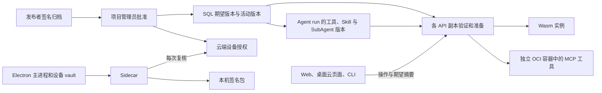

# 独立业务包、最小宿主与设备执行

项目包实现以 `1789c930d` 为起点，并整合了 P4（#49，`56357dd1f`）与 P5（#50，`497386eb2`）。Billing 在已构建的 API、Web 和桌面客户端上安装、升级和回退。知识检索在云登录用户批准的指定设备上运行，账号切换或撤权后原句柄失效。新项目的默认入口由空宿主安装六个签名业务包。既有全量部署仍可使用原基础包。

业务包和适配器的当前目录、实际发布能力与剩余迁移范围见[插件源码导航](../../plugins/README.md)。

## 新环境的首次启动

新 checkout 的 `make init` 在回环地址发布 worker，并在本地签名六个归档。`make dev` 启动独立空数据库、Redis、包宿主与 Web 入口。Helm 的默认 profile 使用相同的[六包选择与授权](../../charts/memstack/files/standard-packages.json)，由部署方挂载预先签名的归档、公钥和首位项目所有者的凭据。详见[部署步骤](../../charts/memstack/README.md)。

启动时 PostgreSQL 的事务锁串行化首次初始化。宿主逐包对比预期身份及允许权限，使用正式安装服务验签、准备执行器并启用。首位普通所有者、租户、项目与安装状态在同一事务内提交。冷启动失败后可以修复输入并重试；已有身份的项目重启后继续使用管理员选择的版本。包内声明的页面随发布摘要加载。原有 Web 与桌面 React 业务页面已归入六包源码，完整客户端的这些路由仍在构建时编译。

旧全量环境升级代码前，需为使用项目聊天的项目安装并启用签名 Agent 包，批准 `agent.loop.drive`。运行准入会固定该包的摘要和授权代次。缺少授权的项目会在模型步骤前停止。空宿主的默认首装已经批准该能力；完整聊天还需要已授权的模型、工具、事件流和聊天传输。交互式 Sandbox 镜像由 Environments 目录独立构建和部署，受限补丁 worker 的包回退只切换该 worker。

### 单包升级和回退的可执行验证

| 包 | 通过正式入口观察的行为 |
| --- | --- |
| [Agent](../../src/tests/integration/test_project_execution_statistics.py) | 同一固定模型输入，新 run 的模型步骤由两轮变一轮，回退后恢复两轮。旧 run 保持原摘要，撤权后停止。 |
| [Automation](../../src/tests/integration/test_automation_schedule_package.py) | 两个 OCI 版本运行相同工作流，周期步骤的时间从 00:00 改为 00:01，回退后恢复；一次性步骤的结果保持一致。 |
| [Environments](../../src/tests/integration/test_environments_package.py) | 同一补丁的换行从 LF 变为保留 CRLF，回退后恢复 LF。每次切换后 Automation 仍可完成工作流。 |
| [Knowledge](../../src/tests/integration/test_signed_graph_projection.py) | 在临时 PostgreSQL 和 Neo4j 中使用签名 OCI 做图投影，改变实体类型的大小写；测试覆盖已准入任务、worker 中断恢复及回退。 |
| [Workspace](../../src/tests/integration/test_package_kernel_image.py) | 已构建的客户端加载签名页面并调用 Rust/Wasm 导出；升级改变 CSV 列名，回退恢复旧列名。 |
| [Billing](../../src/tests/integration/test_standard_project_bootstrap.py) | 从空库部署全部六包，改变一个套餐的配额，重启后继续使用新版本，回退后恢复初值；期间可执行 Environments 的工具。 |

## 部署单元与数据所有权

| 单元 | 持有的状态 | 对外职责 |
| --- | --- | --- |
| 云身份与项目权限 | 登录会话、刷新轮换、租户和项目成员 | 确认当前主体。项目管理员批准安装，具有执行权限的项目成员调用已批准的能力。 |
| 项目包管理 | 不可变签名归档、版本、批准权限、期望与运行版本、上一版本、失败原因 | 本地导入和 OCI 市场安装共用记录；安装按项目串行，成功准备后切换可执行版本。 |
| 执行宿主 | 请求或运行的作用域、制品摘要、执行器、资源租约 | Wasm 运行有界计算；云端 MCP worker 使用单独的受限容器；Sidecar 在指定设备执行批准的包。 |
| 业务包 | 操作及其输入输出、命令、页面、版本、数据模型与迁移 | 单次发布可同时更新后端行为、CLI 命令和客户端操作。Billing 持有发票表的迁移，Tenant 持有配额写入权限。 |
| Web 与 Electron Renderer | 当前作用域、可用命令、已装载页面 | 校验页面字节的摘要，在沙箱 iframe 中显示。点击操作时校验来源窗口和操作 ID，再提交与页面相同的版本摘要。 |
| Electron 主进程与 Sidecar | 应用 vault、设备凭据、验签制品、逐次调用授权 | 账号切换、设备授权撤销或代次失效后拒绝旧句柄。Renderer 通过私有 IPC 请求操作。 |
| 全量 API 的发布与恢复 | 作用域代次、逐机准备状态、数据平面回执 | 正在执行的操作持有已准入代。副本比较本地代与数据库目标代，在完成装配后通过就绪检查。 |

插件自持资源的方式参考了 deepseek-harness 的 `packages/bundle/sdk-minimal/cordis.patch.yml` 和 `packages/client/ui-plan/src/client/index.ts`。MemStack 根据部署的租户边界额外绑定了签名、项目、设备与执行代。

## 与近期合并功能的关系

| 既有运行路径 | 本次落地的变化 | 继续由原功能负责 |
| --- | --- | --- |
| #44 作用域 HTTP、工具和 Canvas | 路由表按实际定义及处理器生成，不同代的 OpenAPI 文案可以独立刷新。先准备目标作用域，再交换请求入口；已有租约继续使用原代。后台恢复在图服务释放后重新取得项目的可用服务。 | 可装载 Skill 的可见性、持久化 cron 派发与交互式 A2UI 的等待／取消。 |
| #45 云登录与 #47 桌面身份 | 云登录会话证明是谁在申请。项目管理员决定哪个用户、设备、包摘要和代次可用；Sidecar 验签并逐次在线复核。后置 Hook 投递失败可单独重试。 | 云刷新轮换、撤销、应用 vault 与数据平面回执各自持有原权限。 |
| #46 运行位置、#48 Composer 与 #49 本机运行 | 运行记录保留机器、环境、目录显示名和执行目标。满足 P4 前置条件后，桌面可发起和停止本机聊天，并将事件与制品上传云端。 | Web 对本机运行只读。安装或执行签名包需要单独的设备授权。 |

[作用域路由发布](../../src/infrastructure/adapters/primary/web/startup/scoped_profile_runtime_v2.py) · [图服务生命周期](../../src/infrastructure/plugins/v2/graph_runtime.py) · [设备授权](../../src/host/identity/device_plugin_grants.py) · [桌面 Composer](../../agi-stack/apps/desktop/src/features/chat/executionPlacementModel.ts)

## 从签名归档到一次调用

1. 发布者将自己的代码、类型化工具声明、命令、UI 文档和权限放在包目录，使用 Ed25519 私钥生成闭合归档。签名覆盖清单与所有制品的摘要。相同签名输入产生相同字节。部署配置通过 `PLUGIN_MARKETPLACE_TRUSTED_KEY_FILES` 信任发布者。
2. Web 插件中心上传文件，调用服务端 inspect 验签，显示包 ID、版本、摘要和待批准权限。OCI 市场另校验 `PLUGIN_MARKETPLACE_ALLOWED_REGISTRIES`、OCI 摘要、不可变目录声明和来源信息。两种入口共享同一份项目 release。
3. 管理员记录版本后启用。宿主先准备候选执行器，成功后更新活动指针。准备失败会记录原因并保留已有活动包；查看状态能区分已安装与可执行版本。禁用和卸载保留项目命名空间，显式 purge 清除该项目的包存储。
4. 每次调用重新读取授权范围、受信密钥及版本撤销状态。Web、桌面云页面和 CLI 提交期望摘要，版本已变化时要求重新读取。数据库事务使多个 PostgreSQL API 副本共享同一项目与制品的调用并发限制。
5. 升级与回退均由项目管理员发起。重新选择原签名版本可恢复其行为；同 ID、同版本、不同摘要的归档会被拒绝。数据迁移由包作者定义可恢复边界。包命名空间有单值与总容量限制。

宿主将项目包操作写入 `plugin_audit.project_package` 结构化日志。安装、启停、卸载、清理、回退和设备授权变更可关联用户与作用域。Wasm 与 OCI 调用另记录执行器、签名工具或命令、包版本和摘要、耗时及成功、失败或取消状态。Agent 委派记下实际用户与 run ID，旧 run 可追溯到升级前的包。审计字段限于身份、操作和发布元数据，日志输出故障时调用方仍收到原来的业务结果。设备授权记录和项目安装状态持久化在数据库；逐次调用日志的持久保存期限由部署的日志收集器配置。

发布者在 SDK 配置的 `compatibility` 中声明宿主 ABI 的闭开区间。默认下界为 `2.0.0`，上界为 `3.0.0`。SDK 将该范围写入签名的 `compatibility.json`。云宿主和设备 Sidecar 在准备候选版本前检查范围；无此文件的旧 V2 包绑定到 ABI `2.0.0`。Web 与桌面管理操作携带所看到的安装修订号，界面过期时服务端返回 HTTP 409。

项目首次装配 ReAct run 时，将实际可用的包版本、摘要和授权代次写入 run 选择记录。进程退出后按同一选择恢复。常规升级只影响新 run。禁用后重新启用会推进授权代次，原句柄继续失效。工具暴露与执行都复核成员角色和运行权限。Skill loader 读取同一签名版本的指令，并应用 agent 的 `allowed_skills`。

批准 `subagents.register` 后，签名包可在 `subagents` 声明中提供名称、说明、系统提示与本包工具清单。ReAct 的结构化委派工具按父 Agent 的 `can_spawn` 与 `allowed_subagents` 提供候选。父策略可以使用跨版本稳定的 SubAgent ID。实际调用和后台续接使用绑定包摘要及授权代次的名称。子 Agent 继承父模型，默认没有工具，也没有 Skill 或继续委派权限。其可调用工具必须同时出现在签名清单与父运行已选工具中。前台执行、后台入场及后续 send/steer 复核项目成员和包授权。



### 独立数据库

最小 API 默认采用 `PACKAGE_KERNEL_DATABASE_MODE=shared`，沿用现有云身份库和完整迁移。新部署可在 `values-package-kernel.yaml` 的 `api.extraEnv` 选择 `standalone`，将挂载配置中的 `DATABASE_URL` 指向专用空 PostgreSQL。此模式创建 18 张身份、项目授权和包运行表，其中两张保存桌面上下文和切换审计，通过 `package_kernel_alembic_version` 单独管理版本。两个迁移入口使用同一个数据库事务锁，并检查对方的版本表。完整数据库同时保留 #49 的本机事件与项目包迁移，无 DDL 的双父迁移 `a86060255286` 合并两个分支。空库、既有插件库、既有 P4 库及双头库均已在临时 PostgreSQL 中验证可重复升级。独立模式支持普通 PostgreSQL 16。

原生客户端通过 `GET /api/v1/tenants/`、`GET /api/v1/projects/` 与项目详情校验云身份的可见作用域，列表支持 `page` 和 `page_size`。上下文从 `GET /api/v1/workspace-context` 读取。已有选择会复核成员资格，只有一个可见项目时可以直接初始化。空宿主遇到多个候选且没有既有选择时，可通过 `POST /api/v1/workspace-context/switch` 提交用户选定的租户、项目、期望修订号和幂等键。完整宿主沿用结构化 Agent 判断。

所有环境的独立模式首次启动后均为空身份库。运维人员可在最小 API 容器中显式运行下列命令，提供项目负责人、租户名、项目名和挂载密码文件。省略文件参数时会从终端隐藏读取密码。首位负责人获得该项目的管理权，能够通过云会话登录、刷新和批准签名包。已有用户时，重复运行会退出并提示初始化已关闭。

```sh
python -m src.cli.package_kernel_owner --email "$OWNER_EMAIL" --tenant "$TENANT_NAME" \
  --project "$PROJECT_NAME" --password-file /run/secrets/initial-owner-password
```

### 共享页面与两个客户端宿主

独立 Web 项目包入口使用与完整 Web 相同的云身份、签名页面组件和项目包 API。在仓库根目录执行 `pnpm --dir web run build:project-packages`，将 `web/dist-project-packages/` 部署到站点根目录，把同源 `/api/` 转发给最小 API。也可执行 `docker build -t memstack-package-web:latest -f web/Dockerfile.project-packages web`，通过 Helm 的空宿主配置部署已构建的静态站点。访问 `/project-packages.html` 可选择当前账户有权读取的项目。直达链接支持 `?tenant=<租户 ID>&project=<项目 ID>&optionalPlugin=<包 ID>`。开发时可通过 `MEMSTACK_API_PROXY` 指定隔离 API，再运行 `pnpm --dir web run dev:project-packages`。

Web 和 Electron 默认从当前项目已启用的发布版本读取页面贡献。一个签名归档中的 `pages` 可以把同一入口发给 `web` 和 `desktop-renderer`，也可以声明不同的目标入口。深链接由贡献声明。运行时先检查 ABI、目标和资源摘要，再在隔离 iframe 中加载资源。切换项目、版本或账户时，原页面的能力通道随之释放。

包作者在归档中提供独立构建的 JavaScript IIFE 及可选 CSS。页面可通过 `window.memstack.scope()` 读取项目、语言、目标及获批操作。使用 `invoke(command)` 调用无参命令，使用 `invoke(command, payload, {signal, onEvent})` 接收进度、取消调用。桌面可通过 `device(tool, payload)` 请求设备授权范围内的操作。用户凭据、设备证明和本机路径由宿主管理。[页面 SDK 类型](../../sdk/memstack-plugin-sdk/src/pageRuntime.ts) · [Billing 共享页面源码](../../plugins/business/billing/ui/shared/WebBillingPage.tsx)

页面可以调用 `navigate(path)` 打开本包声明的路由。要打开其他包的页面，在发起页声明 `"page_links": ["memstack-agent/chat"]`，再调用 `window.memstack.openPage("memstack-agent", "chat")`。宿主从当前项目或租户在本端已安装的版本解析目标地址。目标未安装时返回 `page_destination_unavailable`，调用方可以在原页面显示原因。

要在业务页面内嵌入另一个包，把插槽名和目标页写入来源页的 `anchored_slots`，例如 `{"collab@1": "memstack-workspace/agent-collab"}`。目标页以 `"contributes_to": "memstack-agent/collab@1"` 声明接受嵌入，`routes` 留空。来源页调用 `window.memstack.anchorSlot("collab@1", element, search)`，组件卸载时调用返回的清理函数。宿主在该元素的位置独立装载目标发布，为目标页过滤查询参数，并用目标包的项目、摘要和授权派发操作。拖动分栏时保留子页状态；卸载目标包会关闭其通道和待处理请求。[签名分栏与联合业务测试](../../src/tests/integration/test_installed_agent_panes.py)

独立启动默认桌面客户端使用 `make -C agi-stack run-desktop`。完整旧客户端仍可通过显式 full 配置构建，供迁移中的旧页面使用。固定宿主的浏览器回归在宿主构建后签发未知包，检查深链接、版本切换和回退。[未知包发行与宿主集成测试](../../src/tests/integration/test_package_kernel_image.py) · [六包业务页面验收](../../src/tests/integration/test_standard_project_pages.py)

需要应用数据的页面声明具名命令及对应权限，如项目目录、剧本、会话回放或运行终端。完整 API 使用已有的业务授权接口。最小 API 可通过 `PACKAGE_APPLICATION_RUNTIME_URL` 连接同一云身份及发布库的可信运行时。接收端再次核验用户、项目、命令及归档摘要。纯计算、本地检索和发票 worker 可在各自已声明目标独立执行。会话及工作区历史沿用 P5 云端记录。终端授权还需要项目对应的运行服务及有效 run revision。[云端能力转发](../../src/host/operations/remote_application_commands.py) · [终端运行授权](../../plugins/business/environments/README.md#project-sandbox-and-run-terminal)

桌面和 Web 通过签名 Agent 命令读取云端会话。标准 API 在 PostgreSQL 中保存会话的目标位置、归属以及设备上传的事件。设备开始执行前通过云端读接口确认所属项目和位置，上传采用连续序号去重，终态按修订号提交。Web 可以回放这些记录。配置独立应用运行时时，会话读写与设备上传均交给同一云端权威服务。上传带文件内容的制品还需该服务提供已配置的制品存储。[设备上传协议](../../src/host/transport/local_run_upload.py) · [两轮上传与双端回放测试](../../src/tests/unit/routers/test_package_local_run_history.py)

桌面开发和打包共同使用 `AGISTACK_DESKTOP_PROFILE`。默认安装包携带通用 Sidecar 和校验摘要。完整配置同时构建 Cargo 的 `legacy-business` 功能以及 Workspace Core 和原生辅助程序。macOS 正式版在签署运行时后记录二进制摘要，重新封装应用签名，再交由公证和更新器流程。[桌面打包](../../agi-stack/apps/desktop/scripts/desktop-package-profile.cjs)

Agent 包给 Web 和 Electron 提供同一份签名聊天页面和 Dashboard。Web 可以回放本机运行。桌面执行需要当前发布声明 `device.local-chat`，项目批准安装后，用户还须在设备上批准工作目录和该发布摘要。目录绝对路径与本机模型凭据由设备保存。Sidecar 按运行登记、连续序号和批次幂等键向云端提交事件；取消期间可排空已经产生的事件，终态继续接受相同批次的幂等重投。[Agent 页面](../../plugins/business/agent/ui/signed/useChat.ts) · [设备执行](../../agi-stack/apps/desktop/sidecar/src/local_runtime/device_plugins/local_chat.rs) · [云端上传协议](../../src/application/services/local_run_protocol.py)

默认 Sidecar 只对其认证的控制通道开放设备宿主能力。旧业务 HTTP 路由由 `legacy-business` 编译特性启用；Agent、Workspace、Knowledge 和 Environments 的旧专属路由源码在各包的 `desktop-sidecar/` 下。通用运行状态中仍有为完整客户端保留的辅助实现。[无业务包源码构建检查](../../agi-stack/apps/desktop/scripts/verify-sidecar-package-host.py)

### 计算与容器入口

Wasm 包声明 `wasm` 和 `target`，结构化工具使用 `invoke`。独立 SDK 的 `memstack-plugin-pack package.json --key "$PUBLISHER_KEY_FILE" --out release.mspkg` 可在宿主代码仓库之外运行。字节接口见 [Wasm ABI](../plugin-wasm-score-abi-v1.md)。

发布到 OCI 注册表时可执行下列命令。它只推送按摘要寻址的 manifest 和 blobs，重复执行会复用已上传的内容。私有 registry 的发布凭据可通过 `--token-file` 从文件读入；输出包含市场安装所需的注册表、仓库、manifest 摘要和归档摘要。

```sh
memstack-plugin-publish release.mspkg --registry "$REGISTRY_ORIGIN" --repository official/billing
```

具有 Python、Rust 等依赖的云端业务可声明 `worker` 文件。其内容是 `memstack.mcp-oci-worker/1`、带注册表主机与不可变摘要的 OCI 镜像引用、镜像内可执行文件的绝对路径。发布者还须声明 `target: python`、来源、`mcp.stdio` 工具和输入输出 JSON Schema。调用的工具及 schema 必须与受限容器实际公布的工具一致。每次操作使用独立容器，配置只读根文件系统、非 root 用户、无对外网络、CPU、内存和进程数上限。包只接收本次调用的对象，进度与结构化结果按请求关联。

执行 worker 的部署必须能访问受控 Docker daemon，并通过 `PLUGIN_WORKER_ALLOWED_REGISTRIES` 显式允许镜像来源。默认列表为空。生产部署宜把该权限交给独立执行节点，应用与用户的凭据均留在控制面。当前 API 中的 provisioner 使用宿主的 Docker 配置；在 Kubernetes 上使用独立远程执行节点前，需要运维配置和验收。

### HTTP、页面与 CLI

项目 Sandbox 的 MCP WebSocket 由 Rust Gateway 在可信边界合并工具。客户端通过云身份连接，`tools/list` 在原沙箱工具之外返回本项目已签名、已批准的工具，`tools/call` 按发现时的作用域、版本摘要与授权代次调用。升级后已准入的调用完成原版本，新调用需要重新发现。撤销凭据、角色或包授权会拒绝继续使用旧句柄。客户端可发送 `notifications/cancelled` 回收该次调用的隔离容器。沙箱进程只接收自己的运行时凭据。直接访问沙箱，以及只携带沙箱 cookie 的嵌入式 MCP App，均保留原有工具范围。[项目 MCP 配置与调用](../../sandbox-mcp-server/README.md#signed-project-tools)

项目入口为 `/api/v1/platform-plugins/v2/optional-business/`。项目成员可读取安装列表；管理员可使用 `inspect`、`install`、`enable`、`rollback`、`disable` 和 `uninstall`。页面通过 `/{plugin_id}/ui` 加载目标平台的签名资源。普通调用、命令和流式调用分别使用 `/{plugin_id}/invoke`、`/{plugin_id}/commands` 和 `/{plugin_id}/invoke-stream`。流式端点返回 NDJSON 进度与终态，可通过关闭连接取消操作。

默认 Rust Gateway 将项目包 API 的方法、作用域和认证头转发到 `AGISTACK_PYTHON_UPSTREAM`。新包和新命令沿用通用路径。Gateway 逐块转发 NDJSON，客户端可在 worker 完成前读取进度；断开连接后，Python 宿主取消调用并释放容器。增强搜索的 `POST /api/v1/search-enhanced/advanced` 也由该上游处理。部署需增强搜索时，将这一上游指向包含搜索业务的全量 API。

两个 API 宿主都提供 `GET /api/v1/plugin-marketplace/packages` 和 `POST /api/v1/plugin-marketplace/packages/{plugin_id}/install`。首次登记可提交归档里的 `bundle.json`、发布者公钥、签名及来源；已有目录记录可复用服务端保存的签名指纹。注册表下载完成后会再次核对不可变版本和扫描状态。签名文件导入与市场安装可在同一项目交替使用。

命令行也可为空项目安装业务包。每个文件独立验签，管理员通过 `--approve` 显式授权本次允许的权限。对于只含计划报价和设置页的 Billing 归档：

```sh
memstack --json packages --tenant "$TENANT_ID" --project "$PROJECT_ID" inspect billing.zip
memstack packages --tenant "$TENANT_ID" --project "$PROJECT_ID" install \
  --approve tools.execute --approve ui.slot billing.zip
memstack --json packages --tenant "$TENANT_ID" --project "$PROJECT_ID" list
```

若归档还提供项目发票，需另外批准 `storage.read` 和 `storage.write`。更新时传入新签名归档；项目已有两个实际运行过的版本时可用 `packages --tenant … --project … rollback memstack-billing` 恢复上一个版本。按顺序提供多个归档时，后一个失败会报告已成功启用的包。

已配置调用凭据的 CLI 可直接查询并执行当前版本声明的命令：

```sh
memstack --json plugin memstack-billing --tenant "$TENANT_ID" --project "$PROJECT_ID"
memstack --json plugin memstack-billing quote-pro --tenant "$TENANT_ID" --project "$PROJECT_ID"
```

### 项目搜索和渠道的独立发布

项目管理员可在 `graph_config.cohere_rerank_package` 中选择重排包。`POST /api/v1/search-enhanced/advanced` 先核验项目读取权限，按该项目所在租户查找已分配的 Cohere RERANK 提供者。请求选项和返回分数的转换都运行在同一已验签的 Wasm 版本中。包可见候选数量、位置和分数；模型、地址、凭据、查询与正文由原传输端持有。本机 HTTP 提供者实测单包升级使 `max_chunks_per_doc` 从 1 变为 2，响应首项随之改变，回退后恢复，另一个租户也无法复用该凭据。[Cohere 发布及部署](../../plugins/adapters/models/cohere/README.md)

飞书渠道通过 `extra_settings.task_timeline_package` 选择项目的卡片进度渲染包。包读取任务状态和计数，宿主把前缀、原始任务文本与已绑定群聊组合后发送。两项目实测中，升级、回退和停用只影响选中的渠道。验收使用实际 `FeishuAdapter` 生成卡片，最终外部传输在测试中被拦截。[飞书发布及部署](../../plugins/adapters/channels/feishu/README.md)

### 设备端批准

云端项目的 `device-plugin-grants` 记录用户、设备证明的 SHA-256 摘要、项目、包摘要、运行代、允许操作与到期时间。设备保管证明，每次安装和调用均在线复核。项目成员降级为只读角色时，原有授权不能继续安装或执行。重新授权会产生新授权标识。桌面设置页可查看签名包、批准当前设备、检索本次提交的文档和撤销授权。数据平面凭据单独用于发布 ACK。

原生客户端从仓库根目录执行 `make -C agi-stack run-desktop`。macOS 插件验收通过 Electron 的私有文件 IPC 选入归档，覆盖云登录、安装、页面调用、升级、回退、重启、切换账号和撤销。双目标知识包另在隔离的完整云宿主上通过真实 macOS 文件选择器导入，从设置页批准安装并执行文档检索，核对了命中的文档、行号和摘录。保留云端 worker，升级设备 Wasm 后，同一查询的命中从两份文档变为一份。重新导入并批准旧签名版本后恢复两份。重启后仍可检索，切换同项目账号和撤销设备授权均阻止旧句柄调用。Windows 与 Linux 原生客户端仍待验收。

#49 为本机聊天接入了单独的 `local_run_execute` 与停止通道。本次修复让两个命令通过正式 preload 进入 Electron 主进程。主进程从应用 vault 取得当前云会话，核对用户、当前租户与项目、会话归属，再经私有控制管道提交给 Sidecar。停止指定 run 前另核对它所属的会话。Renderer 只提交本次操作的数据。设备标识、已授权绝对目录及显示名匹配后，Sidecar 先注册云端运行，再按冻结的权限执行本机工具。设备保留绝对路径与待上传记录，云端按序号接收事件和制品。恢复在后续本机调用前及有限次数的重试中触发。Web 只读回放，云端聊天 WebSocket 继续拒绝本机执行请求。插件安装和调用仍逐次检查签名包的设备 grant。隔离 macOS 客户端已在同一云登录会话中调用签名检索包，并通过预配置的本机回环模型读取真实文件，把工具调用、结果和回复上传到云端回放。撤销检索包授权后旧句柄失效。未配置模型时，云端可以成功保存失败记录，桌面按运行结果显示错误。新设备仍缺少在云登录设置页配置本机聊天模型的入口。[桌面本机派发](../../agi-stack/apps/desktop/src/features/chat/localRunDispatch.ts) · [云端本机运行协议](../../src/application/services/local_run_protocol.py)

桌面设备包还需要一个能发布已签名运行快照的云控制面。空宿主镜像提供独立云身份、项目安装和设备授权；其项目安装修订号只用于项目包并发控制。当前原生验收连接完整控制面的 ROOT 发布，Sidecar 和 Renderer 各自领取数据平面凭据、接收并确认目标代。从仅含空宿主的新环境部署原生客户端时，仍需接入这一发布服务。

## 官方业务和发布现状

| 业务或宿主 | 当前可交付单位 | 距离全业务切换还需完成 |
| --- | --- | --- |
| Billing | 签名 OCI 包在空宿主上提供报价、项目发票创建/读取/分页、Web/桌面设置页和 CLI 命令。包内 worker 定义发票字段、幂等规则和到期日，宿主限制每次调用可读写的项目记录。 | 历史发票表只有租户 ID，仍由原租户 API 读取并沿用 Billing 自己的 Alembic 迁移。导入新项目需明确发票所属项目；租户配额变更继续使用 Tenant 所有者授权。 |
| 设备知识检索 | Knowledge 的同一签名归档包含云端 `project_graph` 与设备端 `search_documents`，两端分别校验授权和执行目标 | 设备检索读取本次提交的文档。云端记忆页可按项目查询已持久化的标题和正文。图存储与索引同步使用各自的服务与权限。 |
| Agent、Skill/SubAgent | ToolSet、签名 Skill 与 SubAgent 声明随 run 固定。Agent 包在同一 OCI worker 中驱动 ReAct 的模型步骤、目标判断、观察和停止，并提供 Skill 校验与执行统计，并发布格式审阅 SubAgent，CLI 可按项目执行已批准版本。 | ReActAgent 和 SessionProcessor 的源码已迁入 Agent 包。模型连接、内建工具、既有 SubAgent 模板、会话注册表、并发控制和调度仍由完整运行时装配。后续按业务所有权拆包，并保持取消、流式事件、凭据和恢复的授权边界。 |
| 模型提供者 | OpenAI 与 DeepSeek 各有自己的签名包、项目授权和流式协议映射，可在同一项目分别升级或停用；增强搜索可独立升级 Cohere 重排参数与结果映射。 | 模型 HTTP 传输、路由与池化、Embedding、模型清单以及其他提供者协议仍随平台发布。 |
| 渠道 | 飞书任务开始、完成卡片的进度前缀由独立签名 Wasm 包生成；同一渠道桥接进程按到达顺序发送该会话的卡片与 HITL 事件。 | 渠道连接、回调验签、HITL 卡片与上传位于飞书包的 Python 实现中，运行时仍由现有渠道进程装载。 |
| Workspace Core | 成员目录可在原工作区列表选择项目已启用的签名导出包。Core 查询当前用户所属工作区，包将该页导出为 CSV。 | 工作区创建、成员、任务与计划的写入、事件顺序与持久化事务继续归 Core；其他协作操作仍待独立发布。 |
| 运营统计 | Agent 包计算会话状态、工具、耗时与时间分布。随 Agent 发布升级和回退。 | 其余运营报表、系统管理命令及 Workspace Core 成员权限与事务仍由各自服务负责。 |
| 环境管理 | Environments 的独立 worker 和集群 HTTP 接口共用健康指标计算。实例、部署与模板服务已移入业务源码目录。 | Sandbox 生命周期、MCP 工具服务与旧环境页面源码归入 Environments；部署真实实例和终端仍需配置基础设施权限和 Sandbox 服务。 |
| 工作流 | Automation 持有 asyncio 引擎和处理器。独立 worker 可执行调度工作流，也可预览 cron、单次和间隔作业，与正式调度器共用触发规则。 | 迁移各执行引擎的幂等回调、事件消费位置、撤销与重放。 |
| 记忆图谱、Workspace、系统管理 | 图服务回收、任务恢复、逐副本就绪与最小 API 可单独运行 | 拆出引擎和迁移、清除跨域读写，打包原有前端页面与 Gateway 业务端点。 |
| 部署 | 新环境默认以 `Dockerfile.kernel` 空宿主启动，从签名归档原子安装六个业务包。全量宿主继续提供旧业务与 ROOT 市场发布。Ray 构建只复制所需路径 | 旧全量部署使用 1 个基础包；协议清单及制品数以其构建器输出为准。飞书工厂迁入适配器后有了独立的源码制品。显式启用的旧版全量客户端仍预编译原有页面；Rust Gateway 仍包含部分业务端点。 |

在原工作区目录的 GET 请求中添加 `export_package=memstack-workspace`，可以下载该页的 UTF-8 CSV。BCS 按成员、租户及项目筛选并分页，包仅接收 ID、名称、办公状态和归档标志。导出按本次版本完成；不带该参数的请求继续直接返回 Core 的 JSON。[工作区目录包](../../plugins/business/workspace/README.md)

项目会话可在创建时通过 `agent_config.execution_stats_package` 选择提供执行统计的 Agent 包。宿主先核对会话所有者、项目和租户成员关系，从 SQL 读取最多 1,000 条执行。总数、平均耗时、工具与状态分布、时间桶由无网络 worker 计算。工具名通过本次调用内的整数位置映射，输入不包含思考、消息或工具参数与结果。真实 SQL 历史和 Docker 实测中，单包升级把小时统计改为 15 分钟统计，回退恢复原时间桶。无选择的项目沿用原报表规则。[Agent 包的会话统计](../../plugins/business/agent/README.md)

### 云端 Agent 模型流

管理员可分别启用 OpenAI 和 DeepSeek 的签名 Wasm 适配器，同一项目每种传输最多启用一个适配器。旧的 `model.chat.adapt` 通用授权覆盖两种传输。首次运行固定包摘要和授权代次。每次模型调用把提供者类型、输出预算及是否有工具送入固定版本，按返回的预算发送请求，并按包的决定发布显式推理事件。预算受原请求上限约束，DeepSeek 工具往返需要保留推理字段。宿主在建立请求及交付每个响应块前复核成员角色、包授权、提供者配置修订及租户分配。消息正文、返回文本、模型地址与凭据始终由现有传输处理。消费方结束时会关闭该请求的上游连接。

集成测试从正式项目安装和启用入口部署两个签名版本，在同一进程用标准 Agent 模型流访问本机 HTTP/SSE 上游。测试验证线路上的 token 限制、DeepSeek 工具回合显式推理事件、旧 run 恢复、回退、主动取消断开 TCP，以及撤销包或提供者授权后结束输出。未启用包的新 run 沿用原模型请求；模型池的原始选址和其他模型协议仍由宿主负责。[模型流适配包](../../plugins/adapters/models/openai/README.md)

### 项目内跨包服务

项目包在 v2 模块的 `contract.services` 精确声明提供或需要的服务版本。服务键绑定提供包及工具名，消费工具在签名贡献中声明允许调用的别名。审批时可检查具体服务，并分别授予 `services.call` 和 `services.provide`。部署只接受无宿主导入的 Wasm 计算提供方，OCI worker 通过受控 MCP stdio 提交别名和结构化输入。

项目激活消费者之前会校验其所有依赖。每次调用固定消费者和提供包的摘要及项目授权代次，Agent 运行从已持久化的包集合恢复。独立升级后，新请求取得新行为，已准入请求完成原代计算。停用后再启用会废止原授权代次。撤销、已签合同不兼容或项目不匹配会阻断调用，副本就绪检查同时覆盖依赖包。Billing 的发票 worker 和套餐计算 Wasm 可使用不同发布者密钥独立制作和回退。每次 worker 调用最多请求四次服务，累计输入和输出最多 64 KiB。[Billing 两个发布单元与调用示例](../../plugins/business/billing/README.md#release-the-plan-calculation-independently)

## 旧全量组合的剩余依赖

- **云端装配**。`src/infrastructure/plugins/v2/production_bundle.py` 从仓库文件构建同一基础包，`builtin_modules.py` 仍装配一批 Python 业务实现。单独部署最小宿主可以证明安装协议，但不能替代默认业务迁移。每个新发布单元要声明宿主 ABI、操作 schema、运行目标、权限、需要的宿主能力与迁移所有者。项目 OCI 工具已可按签名别名调用另一个独立签名的纯计算 Wasm 包。版本精确匹配，管理员分别批准双方。其他运行时组合、跨包版本范围及多包联合升级仍待实现。
- **前端与 Gateway**。包内声明的 settings page 和命令可以在固定客户端上显示和执行。旧的 Web 预编译路由树、桌面插件工厂、静态 CLI 业务命令和 Rust Gateway 端点仍存在。逐个迁移时让宿主只拥有通用布局、签名资源加载、导航和受限操作通道，业务包拥有文案、页面贡献、操作与错误处理。
- **状态与数据**。复杂业务调用通过隔离容器运行。需要数据库和外部凭据的业务应先提供最小的租户授权端口和可幂等重试的命令，再迁移对应 worker。包自身负责的新 schema 需独立版本化；共享数据库中的 Billing 发票迁移已有包级版本表。现有知识同步事务、Workspace Core 身份和渠道回调时序均须逐条移交。
- **资源、审计与恢复**。路由表和任务图服务按作用域取代并清理，后置 Hook 从持久化投递记录重试，模型的语义决策由结构化工具调用产生。恢复测试应在真实调用中覆盖重复投递、消费者退出、租约过期和版本撤销。当前 HA 测试在同一 PostgreSQL 上使用两个独立 Uvicorn 容器；生产滚动升级、跨节点 registry 故障、跨区域复制与负载结果仍需按部署验证。

### 工作流图投影包

启用知识同步的项目可以通过项目配置选择独立发布的图投影包。项目管理员同时批准 `graph.projection.compute` 和 `tools.execute`，调用者需要项目执行权限。正式记忆重处理接口按持久化修订采集图抽取结果。worker 只接收节点名、类型、标识和边字段，返回位置化实体与关系。宿主在写同步日志前复核授权、修订、输出大小和端点范围。

数据库保存任务身份、包摘要、授权代次与可重投的抽取结果。投影 worker 失败时，API 后台从快照继续。切换包版本后，已准入任务继续使用原摘要，下一次处理使用新代码。投影日志和任务完成状态在同一 SQL 事务中提交。若提取进程在 Neo4j 写入期间退出且尚未保存快照，数据库租约释放后将任务标为 `review`，需核对图状态。现有 Neo4j 写入跨多个事务，不能从这一状态自动重做抽取。[图投影包和配置](../../plugins/business/knowledge/workers/graph_projection/README.md)

未配置该包的项目沿用原工作流。Python 的独立 episode 后台请求仍以原名 `episode_processing` 和原载荷交给所选引擎。默认 asyncio 处理器要求 SQL Memory 的 ID 与修订，无法处理独立 episode 时在写入任务前返回 HTTP 501。直接调用 Python 的同步 episode 接口，以及经 Gateway 路由到 Rust 的 episode 摄取，仍走各自的同步路径。

实体去重预览按项目读取同名候选。默认 asyncio 引擎没有已存实体合并处理器，因此确认操作返回 HTTP 501。批量优化在启动首个任务前检查所有请求的工作流，预览模式也不会调度增量刷新。能处理实体合并的替代引擎继续接收 `deduplicate_entities`。

## 从旧全量部署移交剩余能力

| 迁移批次 | 移交对象与改动 | 可以移除旧装配的条件 |
| --- | --- | --- |
| 1. Agent 和模型 | Agent 包已持有会话循环；继续移交流式模型适配器和内建工具。由宿主持有 run 的权限、取消、预算、事件持久化和版本选择。 | 同一会话跨 worker 重启可续跑。升级模型包时，进行中的运行继续使用已准入的模型与工具，撤权后拒绝新调用。 |
| 2. 工作流、渠道与知识 | Automation 已持有工作流引擎；继续移交渠道会话、图抽取和索引。让包拥有业务迁移、幂等键与消费位置。 | 针对真实事件重投、断网、进程终止，业务作用只发生一次。跨存储的写入可根据持久化结果重放或明确转入待核对状态。 |
| 3. Workspace 与运营 | Workspace Core 保留其事务、成员权限与事件顺序；由签名操作开放相应业务。旧页面、CLI 与 Gateway 路由依次改用这些操作。 | 固定各客户端与宿主镜像，以新包完成真实项目中的同一操作。停用一个包只撤下其页面、命令与能力。 |
| 4. 新环境与切流 | 在专用新库安装默认签名业务包，验证每个后端、副本、页面和目标设备的可用版本，再发布新主版本。 | 所有承接流量的副本均能验证并运行所选发布；单包升级、失败保留和回退均已在目标环境成功。保留旧部署供切流回退。 |

首次大版本切换可从空宿主和新的已迁移业务数据开始。每个包应先在目标宿主完成独立安装、真实操作、升级失败后的持续服务和回退，再移除对应内建装配。需要所有服务该包的副本实际承诺目标版本才可切流。生产环境的部署与流量切换需要另外执行。

[Billing 构建与授权策略](../../plugins/business/billing/README.md) · [设备检索包](../../plugins/business/knowledge/workers/device_search/README.md) · [Agent 包的 Skill 校验](../../plugins/business/agent/README.md) · [空宿主镜像与 Helm](../../charts/memstack/README.md)
